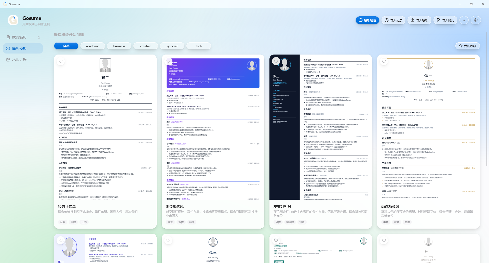
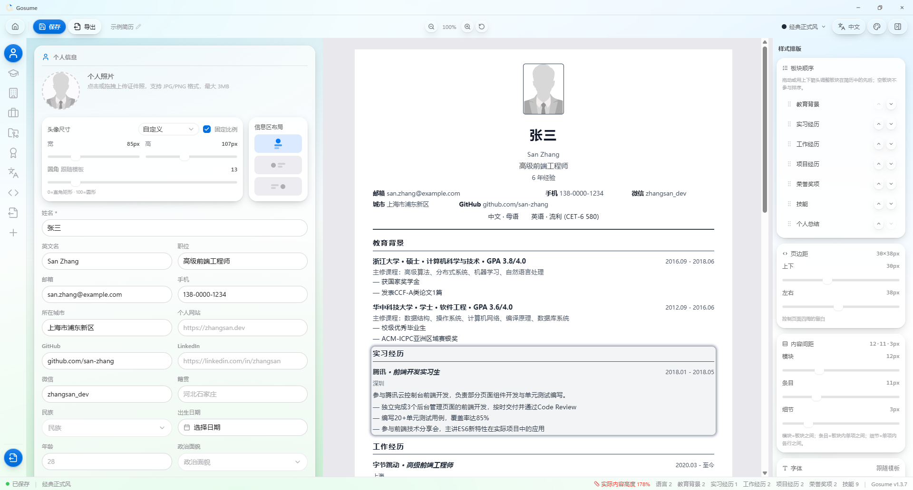
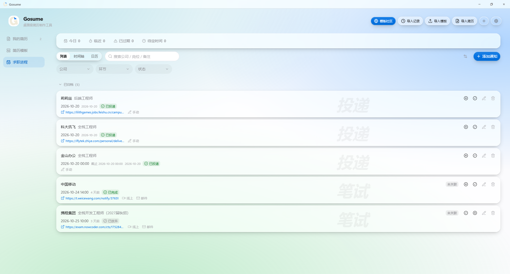
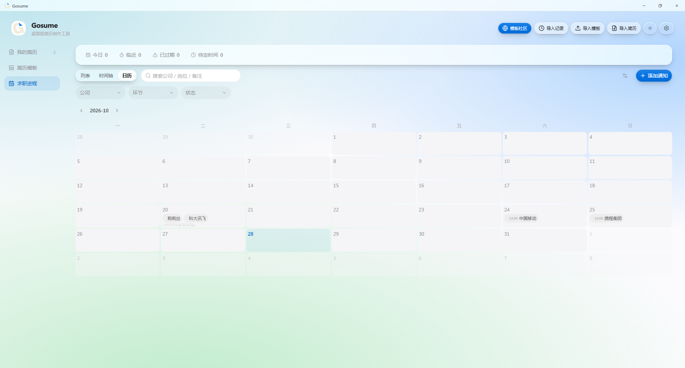
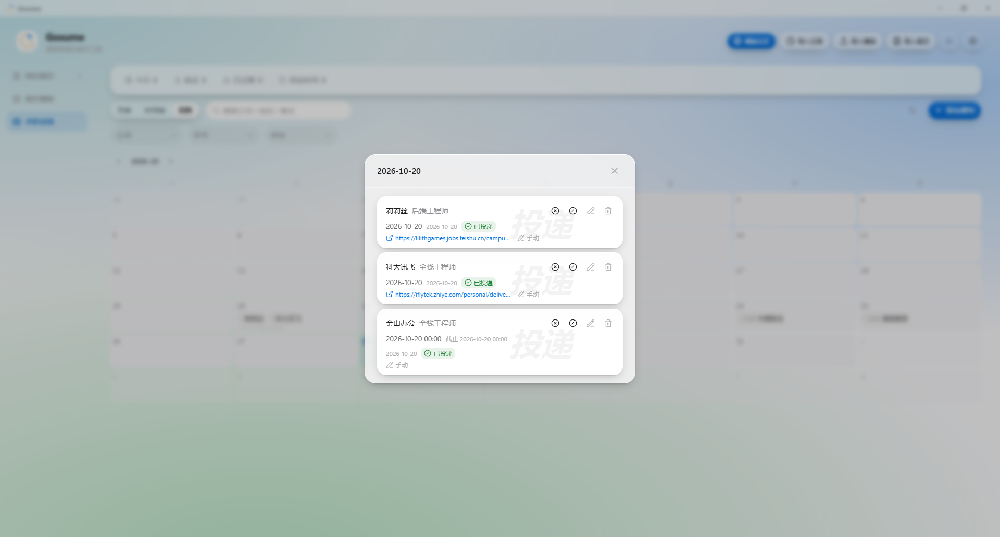
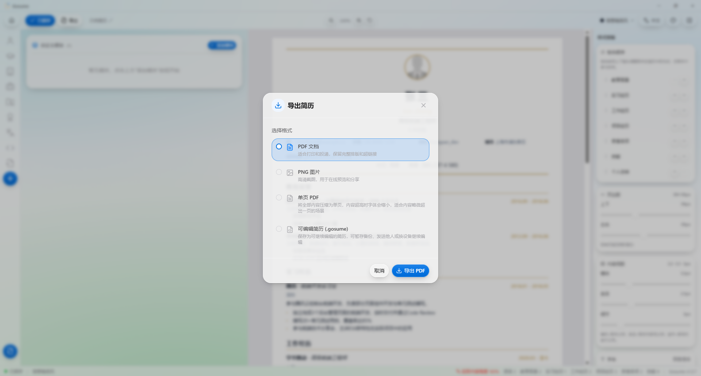
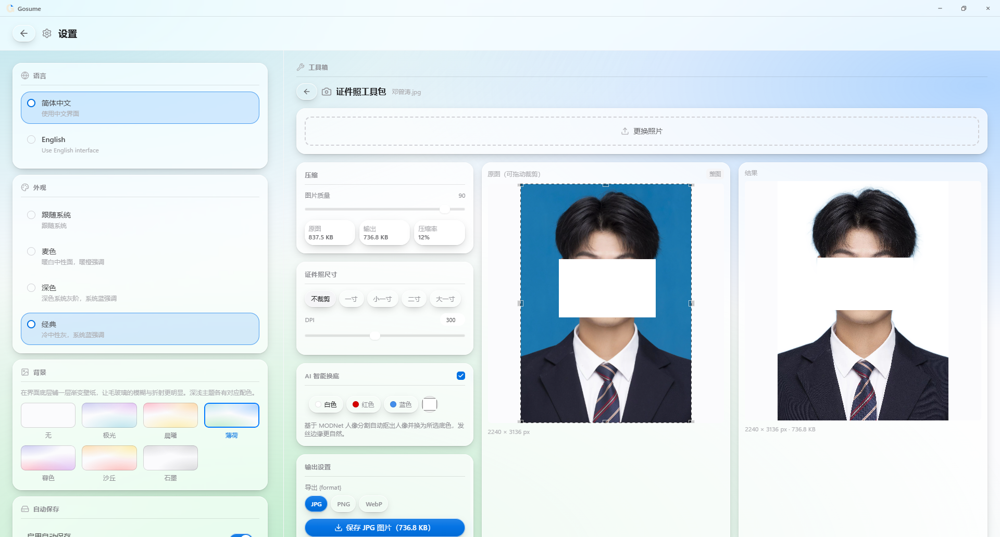

# Gosume

**做简历，其实可以很简单。**

挑个模板 → 填上你的经历 → 导出 PDF。三步就好，不用懂排版。

---

## 界面一览

### 1. 模板库：挑一个顺眼的开始

- 左侧一级导航：**我的简历 / 简历模板 / 求职进程**，当前停在「简历模板」。
- 顶部按 `academic / business / creative / general / tech` 分类筛选模板；卡片展示真实简历缩略图、名称（经典正式风、渐变现代风、左右开栏风、简智精风等）、风格标签，左上角爱心可收藏，右上角可进入「我的资源」。
- 右上角是常用操作：模板社区（仅 dev/test 环境显示）、导入记录（可查看本地 / 分享 / 社区来源的模板导入历史）、导入模板（`.zip` 包，可拖入或通过路径选择）、导入简历（`.gosume` / `.json`）、主题切换与设置入口。

### 2. 编辑器：左边填，右边即时出稿

- **左侧表单**：个人信息、头像（自定义宽高、圆角比例、拖拽上传）、姓名 / 英文名 / 职位、手机 / 邮箱 / 所在地、GitHub / LinkedIn / 个人网站，以及自定义字段、生日、民族、年龄等。
- **中间 A4 预览**：填写内容实时渲染成简历（图中为「张三 / 高级前端工程师」示例），含教育背景、实习经历、工作经历等板块，所见即所得。
- **右侧排版面板**：板块顺序与显隐（基本信息、教育背景、实习经历、工作经历、项目经历、荣誉奖项、技能、个人总结）、页边距（上下 / 左右）、内容间距（模块 / 纵向）、行距、字体与字号缩放。
- **顶部工具栏**：保存 / 导出、预览简历、缩放（80%）、撤销 / 重做、界面语言切换（中文）、主题切换；底部状态栏显示自动保存状态、字数与分页信息。

### 3. 求职进程：列表视图

- 顶部统计条：今日 / 临近 / 已过期 / 待定时间的投递数量；下方可在「列表 / 日历」间切换，按公司 / 岗位 / 备注搜索，并按公司、环节、状态筛选，右上角「添加投递」新增记录。
- 每条记录是一张卡片：公司 + 岗位、投递日期与截止时间、状态标签（已投递 / 已阅读 / 已面试等）、职位链接、备注，以及查看 / 编辑 / 删除等操作。
- 卡片背景的大字水印标出当前环节（投递、笔试…），一眼就能分清进度。

### 4. 求职进程：日历视图

- 同一批投递数据按月历排布，可按月份前后翻页，也能切回列表。
- 有安排的日期格子里直接显示事件，带时间的日程一目了然。

### 5. 求职进程：某日详情

- 点击日历中的某一天弹出当日详情，背景做磨砂模糊处理。
- 弹窗内按条列出当天的全部投递：莉莉丝、科大讯飞、金山办公等，每条保留日期、状态、链接、备注和操作按钮，方便集中回顾一天的进展。

### 6. 导出：四种格式按需选

- **PDF 文档**：保留完整排版与超链接，适合打印和正式投递，按物理 A4 分页。
- **PNG 图片**：高清长图，用于在线预览和分享，保持 A4 宽度、按内容高度拉伸。
- **单页 PDF**：把全部内容压缩到一页（内容过高时字体会缩小），适合只略微超出一页的简历。
- **可编辑简历**：导出为可继续编辑的简历文件，用于暂存备份、发送他人或换台设备接着写。
- 底部提供该格式专属选项（如清晰度）与「导出」按钮，背后仍是编辑器实时预览。

### 7. 设置与工具箱：外观 + 证件照

- **左侧设置**：界面语言（简体中文 / English，与简历渲染语言互不影响）、外观主题（跟随系统 / 麦色 / 深色 / 经典四态）、背景壁纸（无 / 极光 / 蓝莓 / 幻彩等）、启动程序等偏好。
- **右侧工具箱 · 证件照工具包**：上传 / 更换照片后，左侧调压缩、证件照尺寸、AI 智能换底、输出格式；中间是带裁剪框的原图，右侧是结果预览，底部一键保存图片。

---

## 中文

### 它能帮你做什么？

Gosume 是一个装在电脑上的简历制作工具。左边填内容，右边马上就能看到简历长什么样；
觉得 OK 了，点一下导出，PDF 或图片就存好了。不用再在 Word 里反复调格式。

**用起来比较省心的地方：**

- **边写边看**：填什么就显示什么，导出来的和屏幕上一模一样。
- **模板随便挑**：正式、简洁、活泼、技术风……内置多套，不顺眼随时换。
- **不用怕忘保存**：第一次保存之后，后面的修改会自动存到电脑里，不小心关掉也不怕。
- **不用联网、不用注册**：简历只存在你自己的电脑里，不会上传到网上。
- **导出很省事**：PDF 和图片都支持，一次要导出好几份也行。

### 怎么开始？

1. 到 [Releases 页面](https://github.com/muyu0211/Gosume/releases) 下载你电脑系统的安装包
    (Windows 64 位系统，下载 `Gosume-amd64-installer.exe`)
2. 装好后打开 Gosume，挑一个顺眼的模板
3. 按提示填写教育、工作、项目这些经历
4. 点「导出」，选 PDF 或图片 —— 搞定 ✅

> 各个界面的实际长相，请看上面的 [界面一览](#界面一览--screenshots)。

### 支持哪些系统？

+ 目前仅支持Windows，手边没有macos电脑，暂未测试/(ㄒoㄒ)/~~ 

### 有问题或想法？

欢迎在 GitHub 提 Issue。

---

## English

### What does it do?

Gosume is a small desktop app for making resumes. Type on the left, see the result
on the right, and export a PDF or image when you're happy with it. No formatting
headaches, no Word needed.

- **See it as you write** — what's on screen is exactly what you export
- **Plenty of templates** — formal, clean, colorful, techy; switch anytime
- **Your work is safe** — after the first save, changes are kept automatically on your computer
- **Private by default** — no internet, no account, nothing uploaded
- **Easy export** — PDF or image, one resume or several at once

### Getting started

1. Download the installer for your system from [Releases](https://github.com/muyu0211/Gosume/releases)
2. Open Gosume and pick a template
3. Fill in your education, work and project experience
4. Click Export → PDF or image. Done ✅

> Screenshots of every screen: see [Screenshots](#界面一览--screenshots) above.

### Supported systems

Windows / macOS / Linux. Check the Releases page for other platforms.

### Feedback

Issues and suggestions are welcome. Gosume is proprietary software; see [LICENSE](LICENSE).

---

**Gosume — 你的简历，你来做主 / Your resume, crafted.**

